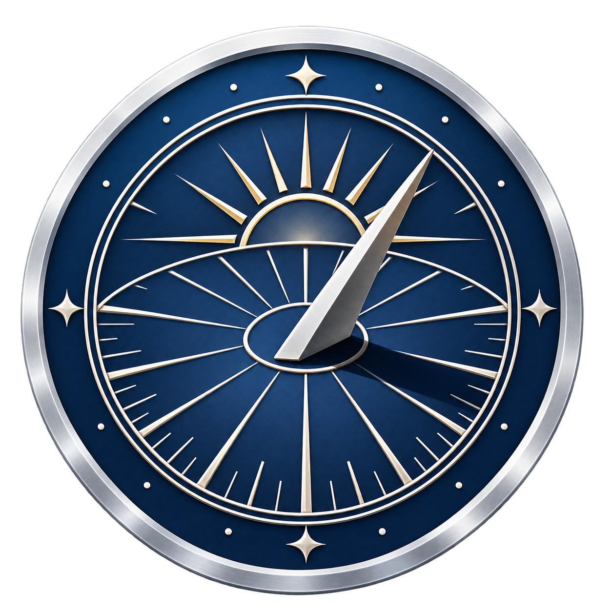
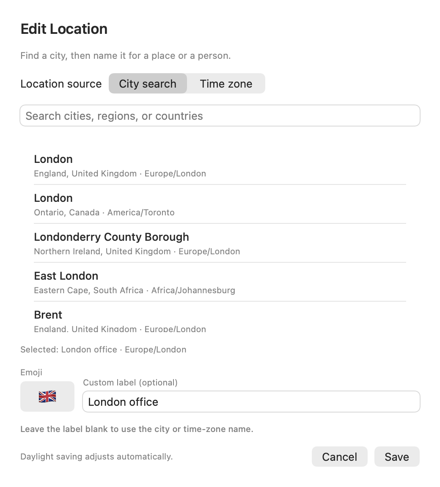
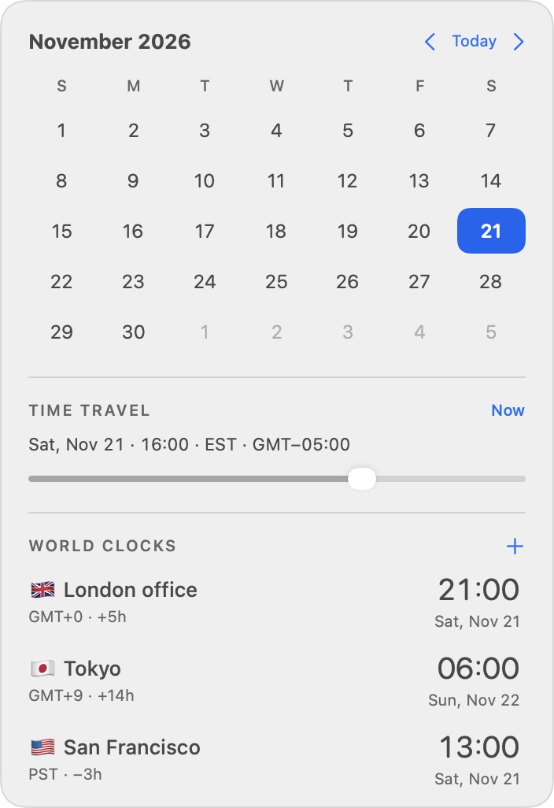
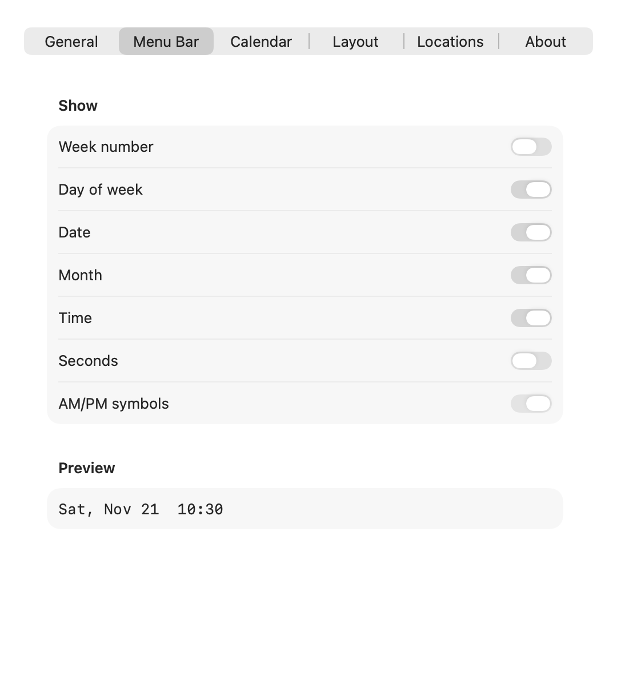
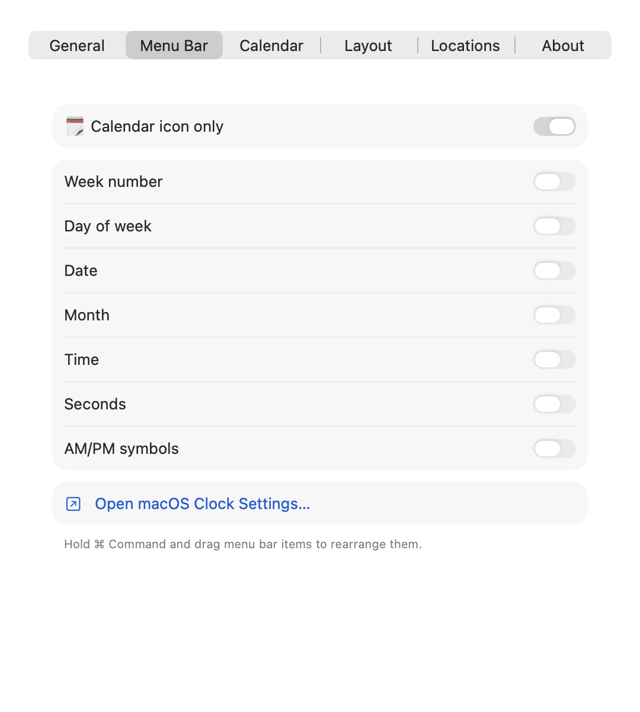
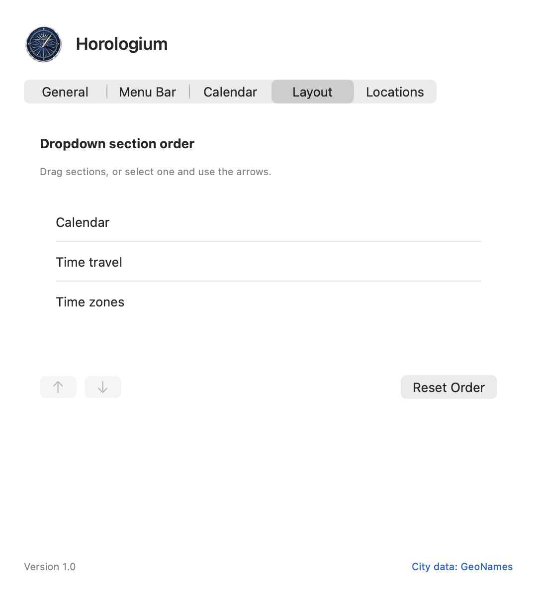
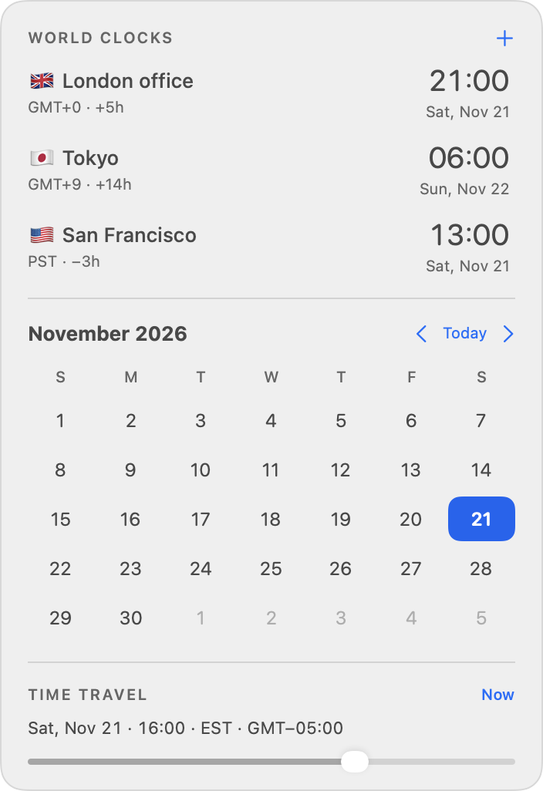
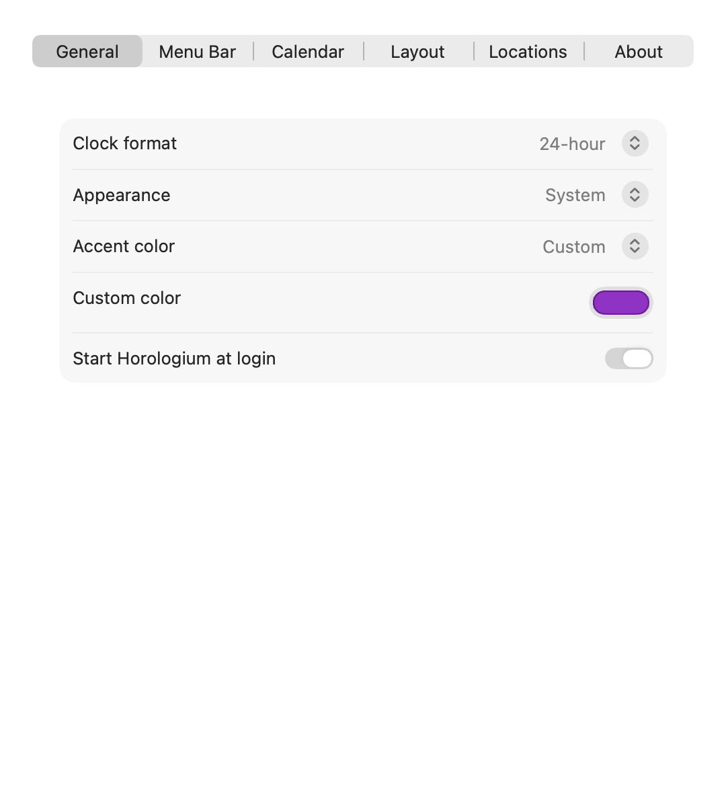
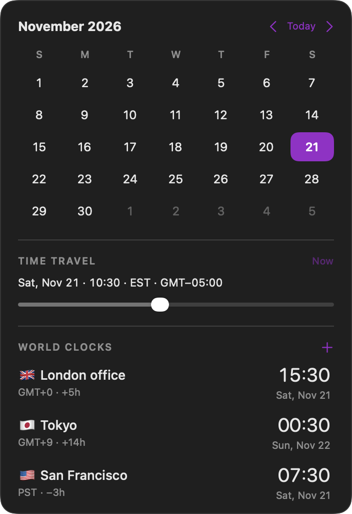
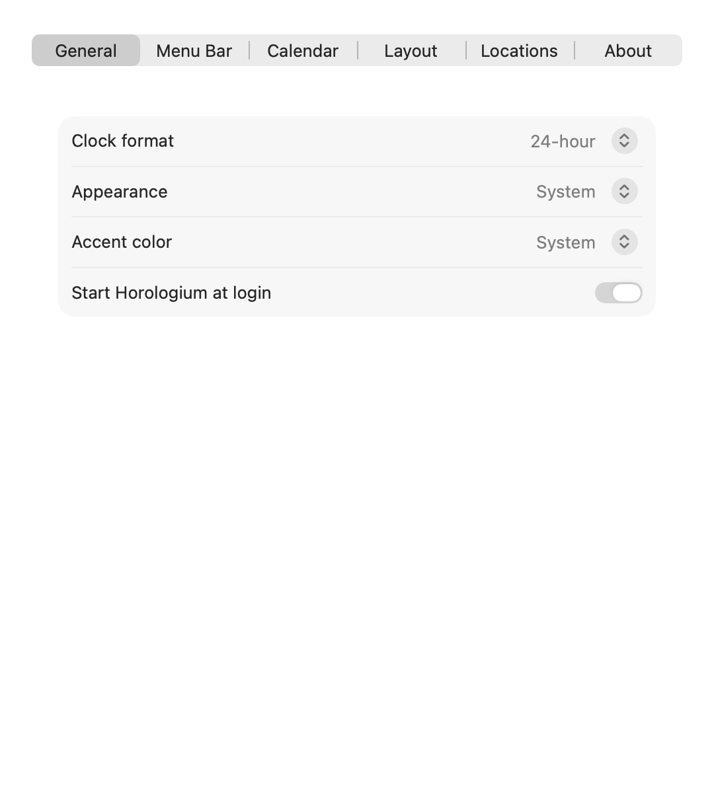

  

<h1 align="center">Horologium</h1>

  A calendar and world clocks, right in your Mac’s menu bar. 
  <strong>macOS 26+ · Apple silicon · Works offline</strong>

Click the menu bar to browse your calendar, see the time where your people are, and compare times across locations. Horologium stays in the menu bar, with a compact dropdown and no Dock icon.

| Light | Dark |
| :---: | :---: |
|  |  |

*App previews are rendered from the actual SwiftUI views with sample locations.*

## A calendar one click away

- Browse a date-only month calendar, with today highlighted and quick month navigation.
- Follow your Mac’s first day of the week, or choose your own.
- Navigate with the arrow keys and press Space to return to today and the current time.
- Open a rounded, arrowless panel that dismisses when you click outside or press Escape.

## World clocks for your people

Find a city, give it a familiar name, and keep its local time close at hand.

- Search more than **34,000 cities offline**, or pick a time zone manually.
- Use custom labels such as **London office**, **Alice**, or **Home**.
- Add a native macOS emoji, with country flags as the picker’s starting category.
- See each location’s time, local date, and difference from your Mac’s time.
- Drag locations into your preferred order.
- Let macOS handle daylight saving and fractional-hour time zones automatically.

| Custom locations and labels | Searchable native emoji |
| :---: | :---: |
|  |  |

## Compare times with time travel

Select a calendar day, then slide through its hours to see the same instant in every saved location. It’s a quick way to find a good time for a call or check what a future time means elsewhere.

Choose **15-, 30-, or 60-minute intervals**. The default is 30 minutes. Click **Now** to return to live time; reopening the dropdown also resets it. When displayed, the menu bar clock keeps showing the actual current time while you explore.

  

## Make the menu bar yours

Choose exactly what appears before you open the dropdown:

- Week number, day of the week, date, and month.
- Time, optional seconds, and AM/PM symbols.
- System, 12-hour, or 24-hour clock format.
- **🗓️ Calendar icon only** for a compact menu bar item.

Right-click the menu bar item for **Settings** and **Quit**. A shortcut in Settings opens the native macOS clock settings, and you can hold **⌘ Command** while dragging menu bar items to rearrange them.

| Date and time options | Calendar icon only |
| :---: | :---: |
|  |  |

## Put things in your order

Arrange **Calendar**, **Time travel**, and **Time zones** however you prefer. Drag the sections in Layout settings, or use the arrow buttons. Your saved locations have their own order too.

| Section order | World clocks first |
| :---: | :---: |
|  |  |

## Match your Mac—or choose your own look

Follow the system’s appearance and accent color, or choose **Light**, **Dark**, and a **custom accent**. The custom color uses the native macOS color picker and is remembered when you switch back to System.

Horologium also includes VoiceOver labels and keyboard navigation.

| Native color picker | Custom accent in dark mode |
| :---: | :---: |
|  |  |

## Take your setup to another Mac

Use **Settings → General → Export Settings…** to save a readable JSON file. Transfer it to another Mac and choose **Import Settings…**.

The file carries your locations, labels, emoji, colors, menu bar options, calendar preferences, and section order. Import shows a confirmation before replacing the current configuration. The format is versioned, with compatibility tests for older files.

Start at login is configured separately on each Mac.

  

## Works offline

Calendar browsing, world clocks, city search, emoji search, time travel, and settings transfer all work without an internet connection. Settings are stored locally on your Mac. There are no accounts, analytics, or calendar-access permissions to set up.

You can also enable **Start Horologium at login** in General settings.

## Build and try it

Horologium requires **macOS 26 or later on Apple silicon**. Open `Horologium.xcodeproj` in Xcode 26 or later and run the **Horologium** scheme on **My Mac**.

See the [development guide](docs/DEVELOPMENT.md) for command-line builds, tests, installer packaging, signing, and notarization. See the [changelog](CHANGELOG.md) for version history.

## Credits

- City data: [GeoNames](https://www.geonames.org/), licensed under [CC BY 4.0](https://creativecommons.org/licenses/by/4.0/).
- Emoji artwork: native macOS emoji. Search names and keywords come from Unicode and CLDR; the [Unicode license](Horologium/Resources/Unicode-LICENSE.txt) is bundled with the app.

Built with SwiftUI and AppKit.

## License

Horologium's source code and documentation are available under the [MIT License](LICENSE).
GeoNames city data and Unicode data retain their respective licenses listed above.
The Horologium name, logo, and app icon are reserved and are not covered by the MIT license.
