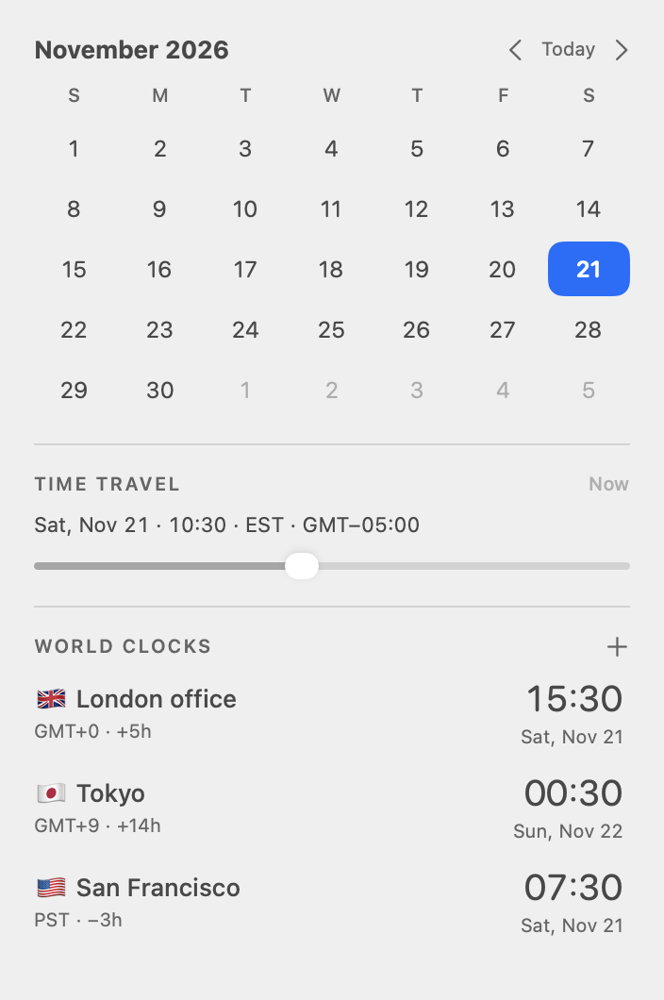
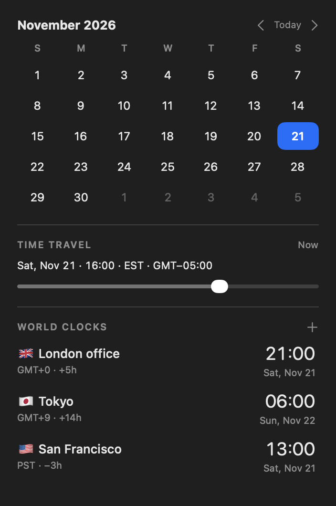
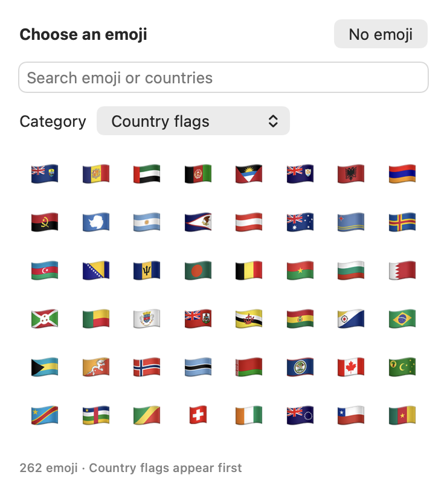

# Horologium

A native macOS menu bar calendar and world clock app from Ardens. Requires **macOS 26+ on Apple silicon**.

Click the date and time in the menu bar to browse a month, check your saved locations, or slide through a day to compare times across the world. City search works offline, and clocks can have personal labels such as “London office.”

## Features

- Compact month calendar with system week-start conventions and keyboard navigation.
- Offline search across 34,248 GeoNames cities, plus manual IANA time-zone selection.
- Custom clock labels, optional native macOS emoji, editing, removal, and reordering.
- Searchable native emoji picker defaulting to Country flags, with All emoji and category filters.
- A plain time-travel slider with 15/30/60-minute snapping (30 by default) and automatic daylight-saving handling.
- Local dates and time differences for every location, including fractional-hour offsets.
- System, 12-hour, and 24-hour formats; system or custom week start; optional start at login.
- Independent menu bar toggles for week number, weekday, date, month, time, seconds, and AM/PM.
- Reorder Calendar, Time Travel, and Time Zones in Settings → Layout.
- System-following appearance by default, with Light/Dark overrides and VoiceOver labels.
- Local preferences only. No accounts, calendar permissions, event notifications, analytics, or runtime network requests.

The menu bar always shows live time. Selecting a day or moving the slider previews the same instant in every location. **Now** resets the preview; reopening the dropdown also returns to live time. Spring-forward days omit nonexistent hours, and fall-back days include both occurrences of repeated hours, identified by their GMT offsets.

## App previews

Rendered from the actual SwiftUI views with sample locations (not desktop screenshots).

| Calendar and world clocks | Time travel |
| --- | --- |
|  |  |

| Dark appearance | Native emoji picker |
| --- | --- |
|  |  |


[Custom location editor](docs/previews/07-custom-location.png)

| Menu bar preferences | Section order |
| --- | --- |
|  |  |

[Week start and slider intervals](docs/previews/09-calendar-settings.png) · [Locations](docs/previews/11-location-settings.png) · [Reordered dropdown example](docs/previews/12-reordered-sections.png)

## Build and run

Open `Horologium.xcodeproj` in Xcode 26 or later, choose the **Horologium** scheme and **My Mac**, then Run. Development does not require a paid Developer Program membership. Use **Sign to Run Locally** if Xcode requests signing configuration.

Or use the bundled scripts (Xcode is selected per command without changing the system developer directory):

```sh
./scripts/build.sh
open build/DerivedData/Build/Products/Debug/Horologium.app
./scripts/test.sh
```

The app lives in the menu bar and does not display a Dock icon. Right-click (or Control-click) the menu bar item for Settings and Quit. The dropdown has no app header or settings footer. If all menu bar text is disabled, a small clock icon keeps the app accessible. Arrow keys move the calendar selection by a day or week; Space returns to now. Command-comma opens Settings. The plus button opens the Locations settings. Clock format and week start follow the Mac’s system preferences by default; both can be overridden independently.

For start at login, install the app at a stable location such as `/Applications` before enabling it. macOS may require approval under System Settings → General → Login Items.

## Installer packages

Create a local installer for development:

```sh
./scripts/package.sh --local
```

Output: `build/packages/Horologium-1.0-local.pkg`. This contains an ad hoc signed app; the package is **not Developer ID signed or notarized** and is for local development.

Once Ardens' Apple Developer Program membership is active:

1. Create **Developer ID Application** and **Developer ID Installer** certificates in the account and import them into Keychain.
2. Store notarization credentials using `xcrun notarytool store-credentials Ardens-notary` and follow its interactive prompts. Do not commit credentials.
3. Run the release workflow with your actual certificate names:

```sh
export APPLICATION_IDENTITY='Developer ID Application: YOUR LEGAL NAME (TEAMID)'
export INSTALLER_IDENTITY='Developer ID Installer: YOUR LEGAL NAME (TEAMID)'
export NOTARY_PROFILE='Ardens-notary'
./scripts/package.sh --release
```

The script builds an arm64 release app, signs it with hardened runtime and a secure timestamp, signs the installer, submits it for notarization, staples the ticket, and verifies the result. The installer places the app in `/Applications`. The bundle and package identifier is **`app.ardens.horologium`**. The test bundle is `app.ardens.horologium.tests`.

Quit an existing Horologium process before installing an updated build, then reopen the app. Automatic updates and App Store distribution are outside this version.

## Project structure and tests

SwiftUI views are hosted by an AppKit status item and transient popover. `TimeEngine` owns calendar and time-zone calculations; `CityCatalog` handles offline search; `AppStore` persists locations and preferences in UserDefaults. Preview time is temporary. Malformed settings are preserved under a recovery key before fresh defaults are used.

The shared Xcode scheme runs unit tests for DST gaps/overlaps, date boundaries, leap days, fractional offsets, search, persistence, and an injectable clock. Visual tests render the actual SwiftUI views with sample locations into XCTest attachments and `/tmp/horologium-previews`. These previews are not desktop interaction tests. Live popover placement, full-screen Spaces, login-item approval, and signed installation should also be checked on a Mac before public distribution.

The Xcode project has no external package dependencies. After adding source/resource files, regenerate its file list:

```sh
python3 scripts/generate-project.py
```

## Artwork and city data

The supplied Horologium logo is in `Artwork/`; the supplied IconKitchen macOS icon is bundled as `AppIcon.icns`.

City data is derived from [GeoNames](https://www.geonames.org/) under [CC BY 4.0](https://creativecommons.org/licenses/by/4.0/), with attribution bundled in the app. The catalog covers cities in GeoNames' `cities15000` extract, not every settlement; use the manual time-zone picker for other locations. It includes a pinned dataset snapshot, so the app needs no download at launch. Time-zone rules come from macOS.

To update the bundled catalog, download `cities15000.zip` and `admin1CodesASCII.txt` from [GeoNames' dump directory](https://download.geonames.org/export/dump/), then run:

```sh
python3 scripts/import-cities.py /path/to/cities15000.zip /path/to/admin1CodesASCII.txt
```

Update the snapshot date in `Horologium/Resources/GeoNames-attribution.txt` when refreshing the data.


Emoji glyphs are rendered by macOS using its native emoji font; no third-party emoji artwork is bundled. Search uses Unicode 16 emoji names and CLDR 46 English keywords, with the Unicode license included in the app. This pinned set supports the minimum macOS version. To refresh the search index:

```sh
# Download emoji-test.txt from https://unicode.org/Public/emoji/16.0/emoji-test.txt
# Download en.xml from https://raw.githubusercontent.com/unicode-org/cldr/release-46/common/annotations/en.xml
python3 scripts/import-emoji.py /path/to/emoji-test.txt /path/to/en.xml
```
